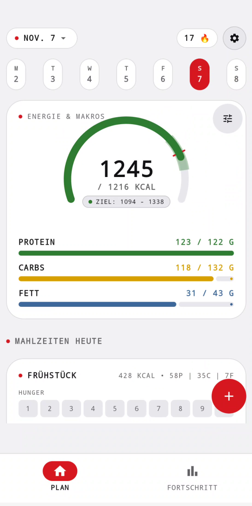
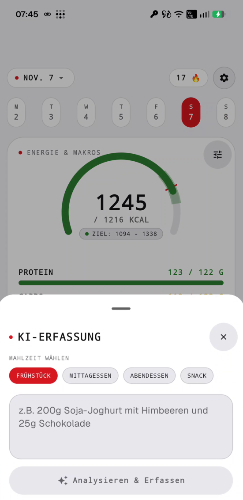
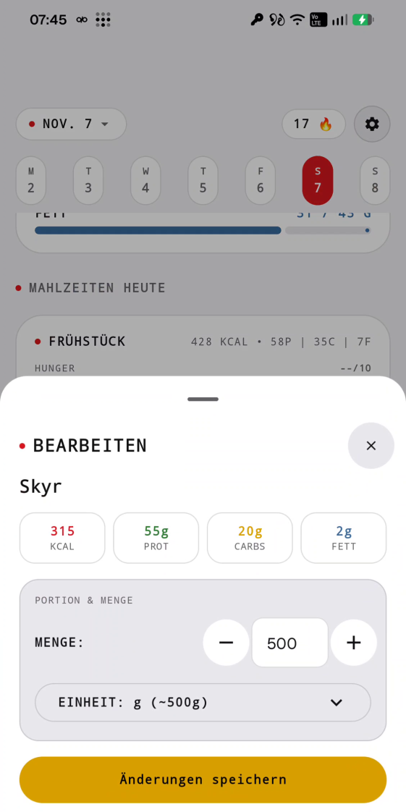
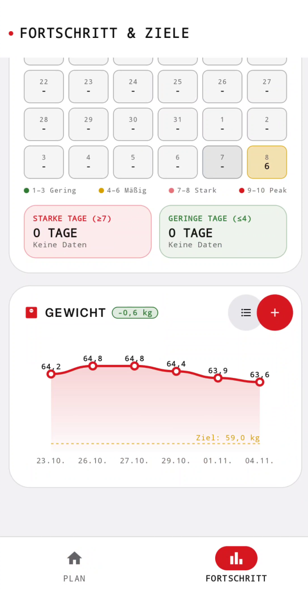
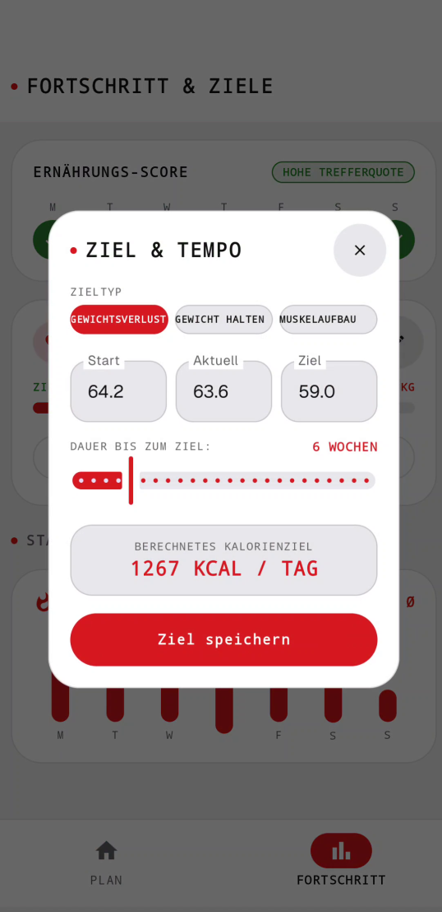
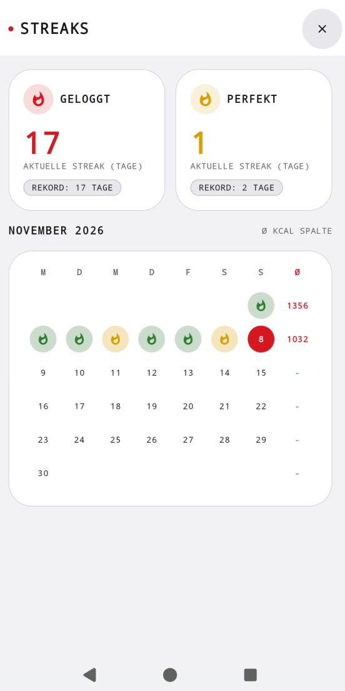
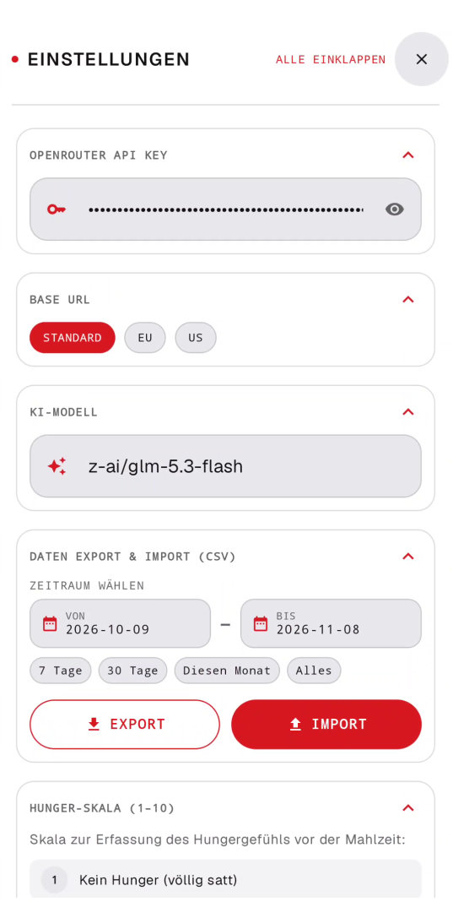

# 🥗 EssMichKI – Smarter KI-Mahlzeiten- & Nährstofftracker

[](https://developer.android.com)
[](https://kotlinlang.org)
[](https://developer.android.com/jetpack/compose)
[](https://nothing.tech)
[](https://developer.android.com/topic/architecture)
[](LICENSE)

**EssMichKI** ist ein moderner, datenschutzfreundlicher Android-Kalorien- und Nährstofftracker im markanten **Nothing OS Design System** (Retro-Futurismus, Schweizer Minimalismus, NDot/Monospace-Typografie und modulare Bento-Grids).

Anstelle mühsamer manueller Suchen in unübersichtlichen Lebensmittel-Datenbanken nutzt die App künstliche Intelligenz über **OpenRouter**: Beschreibe deine Mahlzeit einfach in eigenen Worten, nutze Sprachaufnahmen oder die integrierte Kamera. Die KI extrahiert vollautomatisch und präzise Kalorien, Makronährstoffe (Protein, Kohlenhydrate, Fett) und Zutaten.

---

## 📱 Screenshots & App-Eindrücke

<div align="center">

| 01. Dashboard & Bento-Grid | 02. KI-Mahlzeitenerfassung | 03. Mahlzeit-Details |
| :---: | :---: | :---: |
|  |  |  |

| 04. Fortschritt & Gewicht | 05. Ziele & BMR-Rechner | 06. Streaks & Konsistenz |
| :---: | :---: | :---: |
|  |  |  |

| 07. Einstellungen & OpenRouter |
| :---: |
|  |

</div>

---

## 🌟 Highlights & Hauptfunktionen

### 🤖 Multimodale KI-Mahlzeitenerfassung
- **Freitext, Sprache & Kamera:** Erfasse dein Essen nach Belieben – schreibe Alltagssprache (*"1 Schüssel Haferflocken mit 200ml Hafermilch und 30g Blaubeeren"*), nimm Audio auf oder fotografiere deinen Teller mit CameraX.
- **Offenes KI-Ökosystem via OpenRouter:** Wähle dein bevorzugtes LLM flexibel aus:
  - `google/gemini-2.0-flash-001` *(Empfohlen – rasend schnell, exakt und extrem kostengünstig)*
  - `openai/gpt-4o-mini`
  - `deepseek/deepseek-r1`
  - `anthropic/claude-3.5-haiku`
- **Regionale Router:** Wähle zwischen Standard-, EU- oder US-Endpunkten für optimierten Datenschutz und geringe Latenzen.

### ⬛ Nothing OS 3.0 Designsprache
- **Retro-Futurismus & Schweizer Minimalismus:** Durchdachte monochrome Farbwelten mit ikonischen Nothing-Red-Akzenten (`#D71921`).
- **Bento-Grid-Layouts:** Modulare, klare Kachel-Karten für Mahlzeiten (Frühstück, Mittagessen, Abendessen, Snacks) mit 1px High-Contrast-Borders und **Zero-Drop-Shadows**.
- **Typografie:** Prägnanter Wechsel aus NDot-Matrix, technischer Monospace-Schrift und serifenloser Klarheit.
- **Dynamisches Theming:** Nahtloser Support für Dark Mode und Light Mode.

### 📊 Wissenschaftliche BMR- & Nährstoff-Ziele
- **Evidenzbasierte Grundumsatz-Berechnung (BMR):**
  - *Mifflin-St. Jeor* (moderner Standard)
  - *Harris-Benedict* (bewährte Formel)
  - *Katch-McArdle* (unter Einbezug des Körperfettanteils)
  - *WHO-Formel*
- **Individuelle Makro-Splits:** Feine Justierung von Protein-, Kohlenhydrat- und Fettanteilen passend zu deiner Ernährungsform (High Protein, Balanced, Low Carb, Keto).
- **Zieldefinition:** Konfigurierbares Kaloriendefizit oder -überschuss je nach Fitnessziel (Fettabbau, Erhalt, Muskelaufbau).

### 📈 Fortschritt, Gewicht & Streaks
- **Gewichtstagebuch:** Erfasse dein Körpergewicht täglich und verfolge deine Entwicklung im interaktiven Diagramm.
- **Konsistenz-Streaks:** Baue Logging-Strähnen auf und bleibe dauerhaft motiviert.

### 🔒 100 % Privacy First & Datensouveränität
- **Kein Tracking, keine Zwangs-Cloud:** Deine Mahlzeiten, Gewichtseinträge und persönlichen Metriken verbleiben lokal in deiner **Room SQLite-Datenbank**.
- **DataStore:** API-Keys und Einstellungen werden sicher und verschlüsselt auf deinem Endgerät verwaltet.
- **CSV Import & Export:** Exportiere deine Einträge jederzeit als CSV für Tabellenkalkulationen oder sichere Backups lokal.

---

## 🏗️ Architektur & Technologie-Stack

EssMichKI folgt modernsten Android-Entwicklungsstandards und Best Practices:

- **Programmiersprache:** [Kotlin](https://kotlinlang.org/) (Coroutines, StateFlow)
- **UI & Design:** [Jetpack Compose](https://developer.android.com/jetpack/compose) mit benutzerdefiniertem **Nothing OS Design System**
- **Navigation:** [androidx.navigation3](https://developer.android.com/guide/navigation)
- **Architekturmuster:** MVVM (Model-View-ViewModel) mit Uni-directional Data Flow (UDF)
- **Lokale Datenbank:** [Room DB](https://developer.android.com/training/data-storage/room) mit SQLite und KSP Codegen
- **Konfiguration & Preferences:** Jetpack [DataStore](https://developer.android.com/topic/libraries/architecture/datastore)
- **Netzwerk & JSON:** [OkHttp](https://square.github.io/okhttp/) mit [Moshi JSON](https://github.com/square/moshi) für performante REST-Calls an OpenRouter
- **Kamera:** [CameraX](https://developer.android.com/training/camerax) für Fotoaufnahmen direkt in der App

---

## 🚀 Schnellstart & Einrichtung

### 1. Voraussetzungen
- Ein Android-Smartphone oder Emulator mit **Android 14 (API Level 34)** oder höher (Target: Android 15/16, API 37).
- Ein API-Key von [OpenRouter.ai](https://openrouter.ai/).

### 2. OpenRouter API-Schlüssel hinterlegen

> [!TIP]
> Die Nutzung von `google/gemini-2.0-flash-001` über OpenRouter ist extrem preiswert. Mit bereits $1 Startguthaben können tausende Mahlzeiten analysiert werden!

1. Erstelle ein kostenloses Konto bei [OpenRouter.ai](https://openrouter.ai/).
2. Navigiere zu **Keys** und generiere einen neuen Schlüssel.
3. Öffne **EssMichKI** auf deinem Android-Gerät.
4. Tippe in der oberen Leiste auf das **Profil-/Einstellungs-Icon**.
5. Füge deinen API-Key ein, wähle dein Wunschmodell (z. B. `google/gemini-2.0-flash-001`) sowie den gewünschten Endpunkt (z. B. EU) und tippe auf **Speichern**.

---

## 📖 Bedienungsanleitung

### 🍽️ Mahlzeit hinzufügen
1. Tippe auf dem **Plan / Dashboard** auf den `+`-Button oder direkt in einer der Bento-Karten (*Frühstück, Mittagessen, Abendessen, Snacks*).
2. Beschreibe dein Essen in freier Sprache, nutze die Spracheingabe oder nimm ein Foto deines Tellers auf.
3. Tippe auf **Analysieren** – die KI zerlegt das Gericht in Zutaten, Kalorien, Eiweiß, Kohlenhydrate und Fett.
4. Werte bei Bedarf kurz anpassen und mit **Speichern** in deine Tagesbilanz übernehmen.

### ⚖️ Gewicht erfassen & Ziele justieren
1. Wechsle im unteren Menü auf den Reiter **FORTSCHRITT**.
2. Trage dein aktuelles Gewicht über **"Gewicht eintragen"** ein.
3. Passe über **"Ziele bearbeiten"** deine BMR-Formel, deinen Aktivitätsfaktor oder deinen Makro-Split an.

### 💾 Daten exportieren
1. Öffne die **Einstellungen** (Profil-Icon oben rechts).
2. Wähle **CSV-Export**, um deine Daten als Datei auf deinem Gerät zu sichern.

---

## 🛠️ Für Entwickler

### Voraussetzungen
- **Android Studio:** Ladybug (2024.2) oder neuer
- **JDK:** Java 17
- **Android SDK:** Compile SDK 37, Min SDK 34

### Bauen & Ausführen

1. **Repository klonen:**
   ```bash
   git clone https://github.com/your-username/ess-mich-ki.git
   cd ess-mich-ki
   ```

2. **Debug-APK bauen:**
   ```bash
   ./gradlew assembleDebug
   ```

3. **Unit-Tests ausführen:**
   ```bash
   ./gradlew test
   ```

---

## 📄 Lizenz

Dieses Projekt ist unter der [MIT Lizenz](LICENSE) lizenziert.
